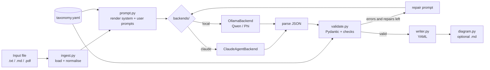

# Argumentation pipeline — implementation plan

**Audience:** implementing agent.
**Goal:** turn a research document (`.txt`, `.md`, `.pdf`, or an extensionless or plain-text file) into a Phase 1 argument-map YAML that validates against the schema used by the three gold files.
**Status:** template. The taxonomy will change, so everything category-specific must be read from `prompts/taxonomy.yaml` and must not be hard-coded.

---

## 1. Context

Inputs that already exist; read them before starting:

| Path                                                                            | What it is                                                                           |
| ------------------------------------------------------------------------------- | ------------------------------------------------------------------------------------ |
| `ocado_phase1_argument_map_gold_v04.yaml`                                     | Gold map with the schema header comments. **Reference schema.**                |
| `ms_d1_sales_argument_map_gold_v04.yaml`                                      | Gold map for a sales note.                                                           |
| `ing_fx_daily_argument_map_gold_v04.yaml`                                     | Gold map for a PDF-converted note.                                                   |
| `sample.json`, `sample_long.txt`, `tests/email_parser_samples_output.txt` | Source texts for the gold maps. `sample.json` is plain text despite its extension. |
| `src/argumentation/diagram.py`                                                | `ArgumentMapDiagram`: YAML → Mermaid. Do not change its behaviour.                |
| `config/theme/argument_map.json`                                              | Colours and labels shared with the diagram and the future front end.                 |
| `src/argumentation/prompts/taxonomy.yaml`                                     | Claim types, modalities, roles, rules. **Single source of truth.**             |
| `src/argumentation/prompts/system_prompt.md`                                  | System prompt template with `{{PLACEHOLDERS}}`.                                    |
| `src/argumentation/prompts/user_prompt.md`                                    | User message template.                                                               |
| `src/argumentation/docs/claim_type_decision_tree.md`                          | Type decision tree (documentation only).                                             |

Project conventions (from `pyproject.toml`):

- Python 3.12, ruff with line length 120, Google-style docstrings, annotated signatures.
- Imports use the `src.` prefix (`from src.argumentation import ...`).
- Tests live in `tests/`; both unittest and pytest are used.

---

## 2. Architecture



---

## 3. File layout to create

```
src/argumentation/
  __init__.py            # export run_pipeline, ArgumentMap, ArgumentMapDiagram, load_theme
  PLAN.md                # this file
  pipeline.yaml          # default runtime config (section 9)
  schema.py              # Pydantic models (section 5)
  taxonomy.py            # load + expose taxonomy.yaml (section 4)
  ingest.py              # file loading + normalisation (section 6)
  prompt.py              # template rendering (section 7)
  validate.py            # semantic checks + error objects (section 8)
  writer.py              # ordered YAML output
  pipeline.py            # orchestration + repair loop (section 10)
  evaluate.py            # compare a map against a gold map (section 12, milestone M5)
  cli.py                 # command-line entry point (section 11)
  backends/
    __init__.py          # get_backend(config) -> ModelBackend
    base.py              # ModelBackend Protocol
    claude_agent.py      # Claude Agent SDK backend
    ollama_local.py      # local Qwen/Phi backend via Ollama
  prompts/  docs/        # already exist
tests/
  test_argumentation_schema.py
  test_argumentation_validate.py
  test_argumentation_prompt.py
  test_argumentation_pipeline.py
```

---

## 4. `taxonomy.py`

```python
@dataclass(frozen=True)
class Taxonomy:
    version: str
    claim_types: dict[str, dict]           # name -> {definition, include, exclude, fixed_modality?}
    type_decision_order: list[dict]        # [{type, test}]
    modalities: dict[str, dict]            # name -> {definition, example_cues}
    roles: dict[str, dict]                 # name -> {definition, allowed_types}
    rules: dict[str, list[str]]            # section -> bullets

    @property
    def argument_roles(self) -> list[str]: ...  # roles minus "core_claim", in file order

def load_taxonomy(path: Path = DEFAULT_TAXONOMY_PATH) -> Taxonomy: ...
```

**Rule:** no Python `Enum` or `Literal` for claim types, modalities or roles. Validate membership against the loaded taxonomy so the categories can change without code edits.

---

## 5. `schema.py` — Pydantic models

These mirror the gold YAML exactly; field order matters for output.

```python
class DocumentMeta(BaseModel):
    title: str | None; publisher: str | None; authors: list[str] = []
    desk: str | None = None; asset_classes: list[str] = []
    source_email_sent_at: str | None = None; publication_date: str | None = None
    source_preprocessing: list[str] = []; source_notes: list[str] = []

class Evidence(BaseModel):
    id: str     # ^E\d{3}$
    text: str

class Statement(BaseModel):
    id: str     # ^S\d{3}$
    brief: str
    statement: str
    claim_type: str
    modality: str
    modality_cue: str   # non-empty
    evidence: list[str] # >= 1, E-ids

class Argument(BaseModel):
    id: str     # ^A\d{3}$
    summary: str
    core_claim: str
    supporting: list[str] = []; rationale: list[str] = []; risks: list[str] = []
    conditions: list[str] = []; catalysts: list[str] = []

class Exclusion(BaseModel):
    text: str; reason: str

class ArgumentMap(BaseModel):          # full file (gold or pipeline output)
    schema_version: str
    document: DocumentMeta
    evidence: list[Evidence]
    statements: list[Statement]
    arguments: list[Argument]
    rejected_links: list[dict] = []    # gold-only, optional
    exclusions: list[Exclusion] = []
    adjudication_notes: list[str] = [] # gold-only, optional

class ModelOutput(BaseModel):          # what the LLM must return
    document: DocumentMeta
    evidence: list[Evidence]
    statements: list[Statement]
    arguments: list[Argument]
    exclusions: list[Exclusion] = []
```

- Pydantic does **structural** checks only: field types, ID regexes, non-empty cue, at least one evidence ref.
- Taxonomy-dependent and source-dependent checks belong in `validate.py`.
- `ModelOutput.model_json_schema()` provides `{{OUTPUT_SCHEMA}}` and the constrained-decoding schema.
- Role field names must equal `taxonomy.argument_roles`. Add a unit test that fails if they diverge.

---

## 6. `ingest.py`

```python
@dataclass
class SourceDocument:
    path: Path
    raw_text: str
    text: str          # normalised; evidence is matched against this
    metadata: dict     # filename, page_count (pdf), char_count

def load_document(path: Path, config: PreprocessConfig) -> SourceDocument: ...
def normalise(text: str, furniture_patterns: list[str]) -> str: ...
```

**Loading**

- `.pdf`: use `pypdf.PdfReader`, extract each page and join pages with `"\n\n"`.
- Any other extension: read as UTF-8 text.

**`normalise` steps, in order** (reproduce exactly; the gold files depend on them):

1. Replace each furniture pattern that contains `\n` with a single space. These patterns match the raw layout.
2. Join line-break hyphenation: `re.sub(r"-\n(?=\w)", "-", text)`.
3. Collapse whitespace: `re.sub(r"\s+", " ", text)`.
4. Replace each remaining furniture pattern with a single space, then collapse whitespace again.

The default patterns go in `pipeline.yaml` (section 9). They must make all three gold files validate.

Reject inputs longer than `max_input_chars` with a clear error. Chunking is out of scope for v1.

---

## 7. `prompt.py`

```python
def render_system_prompt(taxonomy: Taxonomy, example: ArgumentMap | None = None) -> str: ...
def render_user_prompt(doc: SourceDocument) -> str: ...
def render_repair_prompt(doc: SourceDocument, previous_json: str, errors: list[ValidationIssue]) -> str: ...
```

Fill `system_prompt.md` placeholders as Markdown:

| Placeholder                 | Content                                                                                                                                                                           |
| --------------------------- | --------------------------------------------------------------------------------------------------------------------------------------------------------------------------------- |
| `{{CLAIM_TYPES}}`         | One `### NAME` block per type: definition, then `Include:` and `Exclude:` bullets. Add the fixed modality note if present.                                                  |
| `{{TYPE_DECISION_ORDER}}` | Numbered list: `1. **RECOMMENDATION**: Does the statement advise an action?`                                                                                                    |
| `{{MODALITIES}}`          | One bullet per modality: name, definition, example cues in backticks.                                                                                                             |
| `{{ROLES}}`               | Table: role, definition, allowed types.                                                                                                                                           |
| `{{RULES}}`               | One `### Section` per rules key, bullets underneath.                                                                                                                            |
| `{{OUTPUT_SCHEMA}}`       | `json.dumps(ModelOutput.model_json_schema(), indent=2)`.                                                                                                                        |
| `{{EXAMPLE}}`             | Empty string, or `# Example` plus the example map serialised as JSON. Use one gold file, by default the shortest (MS), excluding `rejected_links` and `adjudication_notes`. |

`user_prompt.md` placeholders:

- `{{DOCUMENT_METADATA}}`: YAML dump of `doc.metadata`.
- `{{DOCUMENT_TEXT}}`: `doc.text`, the normalised text, so the model's verbatim copies match the validator.

After rendering, assert that no `{{` remains.

**Repair prompt:** the original user prompt, then `<previous_output>` JSON, then `<validation_errors>` with one error object per line, then the instruction: *"Return the full corrected JSON object. Fix every error; do not change anything that was not flagged."*

---

## 8. `validate.py`

```python
@dataclass
class ValidationIssue:
    code: str
    severity: Literal["error", "warning"]
    path: str            # JSONPath, e.g. "$.statements[3].modality_cue"
    message: str
    suggested_action: str

def validate(map_: ModelOutput | ArgumentMap, source_text: str, taxonomy: Taxonomy) -> list[ValidationIssue]: ...
def argument_edges(map_) -> list[tuple[str, str, str]]: ...  # (source_arg, role, target_arg)
```

Checks (all must exist; codes are stable API):

| Code                         | Severity | Rule                                                                                      |
| ---------------------------- | -------- | ----------------------------------------------------------------------------------------- |
| `DUPLICATE_ID`             | error    | IDs unique within evidence, statements and arguments.                                     |
| `EVIDENCE_NOT_VERBATIM`    | error    | `evidence.text` is a substring of the normalised source.                                |
| `EVIDENCE_UNUSED`          | warning  | Every evidence ID is referenced by a statement.                                           |
| `UNKNOWN_EVIDENCE_REF`     | error    | A statement references a non-existent evidence ID.                                        |
| `UNKNOWN_STATEMENT_REF`    | error    | An argument references a non-existent statement ID.                                       |
| `INVALID_CLAIM_TYPE`       | error    | `claim_type` is not in the taxonomy.                                                    |
| `INVALID_MODALITY`         | error    | `modality` is not in the taxonomy.                                                      |
| `FIXED_MODALITY`           | error    | A type with `fixed_modality` (OBSERVATION) uses a different modality.                   |
| `CUE_NOT_IN_EVIDENCE`      | error    | `modality_cue` is a substring of at least one of the statement's evidence texts.        |
| `CORE_DUPLICATE`           | error    | A statement is the core claim of more than one argument.                                  |
| `ROLE_TYPE_MISMATCH`       | error    | The statement type is not in `roles[role].allowed_types`. This includes `core_claim`. |
| `STATEMENT_UNREFERENCED`   | error    | Every statement appears in at least one argument.                                         |
| `SELF_REFERENCE`           | error    | An argument lists its own core claim in one of its roles.                                 |
| `DUPLICATE_ROLE_MEMBER`    | error    | An argument lists the same statement more than once across its roles.                     |
| `SUMMARY_CITES_NON_MEMBER` | error    | Every `S\d{3}` in a summary is the core claim or a role member.                         |
| `ARGUMENT_CYCLE`           | error    | The graph of argument edges (core claim reused in another argument) is acyclic.           |
| `EXCLUSION_NOT_VERBATIM`   | warning  | Exclusion text is a substring of the source.                                              |
| `BRIEF_TOO_LONG`           | warning  | A brief has more than 10 words.                                                           |

Every issue carries a concrete `suggested_action`, for example *"Copy the span exactly from the document; only whitespace may differ."*

---

## 9. `pipeline.yaml` (default config)

```yaml
backend: claude                 # claude | local
temperature: 0
max_repairs: 2
max_input_chars: 120000
few_shot_example: ms_d1_sales_argument_map_gold_v04.yaml   # path relative to repo root, or null
schema_version: phase1-0.5
claude:
  model: null                   # null = SDK default; set explicitly when benchmarking
local:
  provider: ollama
  model: qwen2.5:14b-instruct   # alternatives: qwen2.5:7b-instruct, phi4, phi3.5
  host: http://localhost:11434
  num_ctx: 32768
preprocessing:
  furniture_patterns:
    - '\nOverweight\nOCDOLN\n2\n'   # contains \n, so applied before whitespace collapse
    - 'Article \| \d{1,2} \w+ \d{4} \d+ THINK Economic and financial analysis'
```

**Note on furniture patterns:** patterns containing `\n` run **before** whitespace collapse; all others run after (section 6). Document this in `normalise`'s docstring.

---

## 10. `pipeline.py`

```python
@dataclass
class PipelineResult:
    map: ArgumentMap
    issues: list[ValidationIssue]   # remaining after repairs
    attempts: int
    raw_outputs: list[str]          # every model response, for audit

def run_pipeline(input_path: Path, config: PipelineConfig, backend: ModelBackend | None = None) -> PipelineResult: ...
```

Steps:

1. `load_document`, then `load_taxonomy`, then render the prompts.
2. `raw = backend.generate(system, user, json_schema)`.
3. Parse with `json.loads` on the substring from the first `{` to the last `}`, so stray fences are tolerated. Then `ModelOutput.model_validate`. Report a parse failure as issue code `INVALID_JSON` and send it to repair.
4. `issues = validate(...)`. If there are no errors, stop. Otherwise, if repairs remain, build the repair prompt and go back to step 2.
5. Wrap the result in `ArgumentMap(schema_version=config.schema_version, ...)`.
6. Fill `document.source_preprocessing` from the config.
7. Return the result.

**Never** write a map that has errors as if it were valid (see section 11).

### Backends (`backends/`)

```python
class ModelBackend(Protocol):
    name: str
    def generate(self, system_prompt: str, user_prompt: str, json_schema: dict) -> str: ...
```

**`ClaudeAgentBackend`** (`claude-agent-sdk`, optional dependency):

- Use `claude_agent_sdk.query(prompt=user_prompt, options=ClaudeAgentOptions(system_prompt=system_prompt, model=cfg.model, max_turns=1, allowed_tools=[]))`.
- Concatenate the text blocks of each assistant message.
- Wrap the async iteration with `asyncio.run`.
- No tools: the task is pure text-to-JSON.
- The SDK needs the Claude Code CLI and `ANTHROPIC_API_KEY`. Raise a clear error if either is missing.
- **Verify the class and field names against the installed SDK version before coding.**

**`OllamaBackend`** (`ollama`, optional dependency):

- Call `ollama.Client(host).chat(model=..., messages=[system, user], format=json_schema, options={"temperature": cfg.temperature, "num_ctx": cfg.num_ctx})`.
- Return `response["message"]["content"]`.
- Passing the JSON Schema as `format` gives constrained decoding.

**Selection:** `get_backend(config)` dispatches on `config.backend`. `--backend` and `--model` on the CLI override the config.

Add `FakeBackend(responses: list[str])` in tests only, for deterministic tests.

---

## 11. `cli.py` and `writer.py`

```
python -m src.argumentation.cli INPUT [-o OUT.yaml] [--backend claude|local] [--model NAME]
                                      [--config PATH] [--diagram OUT.md] [--no-example]
```

- **Default output path:** `<input stem>_argument_map.yaml` beside the input.
- **On remaining errors:** write `<out>.invalid.yaml`, plus `<out>.issues.json` with the issue list. Exit with code 2.
- **Writer:** `yaml.safe_dump(data, sort_keys=False, allow_unicode=True, width=10_000)`. The key order must match the gold files: `schema_version, document, evidence, statements, arguments, rejected_links?, exclusions, adjudication_notes?`. Omit the empty gold-only keys.
- **`--diagram`:** call `ArgumentMapDiagram(map_dict).save(path)`.

---

## 12. Tests and acceptance criteria

**Gold fixtures:**

| Gold file | Source                                    | Slice                                                                       |
| --------- | ----------------------------------------- | --------------------------------------------------------------------------- |
| Ocado     | `sample.json`                           | whole file                                                                  |
| MS        | `tests/email_parser_samples_output.txt` | from the first `"Sentiment"` to the first `"help."` after it, inclusive |
| ING       | `sample_long.txt`                       | whole file                                                                  |

**Tests:**

1. **`test_argumentation_schema.py`:** each gold file loads into `ArgumentMap`. Role field names equal `taxonomy.argument_roles`.
2. **`test_argumentation_validate.py`:**
   - Each gold file validates with zero errors against its normalised source.
   - Mutation tests: copy a gold map, introduce one defect, and assert the expected code appears. Cover `EVIDENCE_NOT_VERBATIM`, `CUE_NOT_IN_EVIDENCE`, `ROLE_TYPE_MISMATCH` (move an OBSERVATION into `supporting`), `CORE_DUPLICATE`, `STATEMENT_UNREFERENCED`, `SUMMARY_CITES_NON_MEMBER` and `ARGUMENT_CYCLE`.
3. **`test_argumentation_prompt.py`:**
   - The rendered system prompt contains every claim type and role name, and no `{{`.
   - The schema embedded in it parses as JSON.
4. **`test_argumentation_pipeline.py`:**
   - With `FakeBackend([gold_json])`, the pipeline returns no errors and writes YAML that reloads to the same statements and arguments.
   - With `FakeBackend([broken_json, gold_json])`, the pipeline repairs on attempt 2.
   - `FakeBackend(["not json"] * 3)` exits with `INVALID_JSON` after `max_repairs`.

**Done when:**

- `ruff check src/argumentation tests` passes.
- All tests pass without network access.
- The CLI runs end to end with `--backend local` against a running Ollama.

**Milestone M5 (after the above): `evaluate.py`**

```
python -m src.argumentation.evaluate PRED.yaml GOLD.yaml
```

It reports:

- **Evidence recall:** the share of gold evidence spans covered by a predicted span (character overlap ≥ 80%).
- **Statement match:** a predicted and a gold statement match when they share evidence and the token F1 of their text is ≥ 0.5. Report claim-type accuracy and modality accuracy on matched pairs.
- **Argument-edge F1:** compare edges after mapping predicted core claims to gold via the statement matches.

---

## 13. Dependencies

Add the following to `pyproject.toml`:

```toml
dependencies = [ ..., "pyyaml>=6", "pypdf>=4" ]

[project.optional-dependencies]
claude = ["claude-agent-sdk"]
local = ["ollama>=0.4"]
```

Import optional backends lazily inside `get_backend`, so tests and the local backend work without the Claude SDK installed.

---

## 14. Implementation order

1. `taxonomy.py`, then `schema.py`, then `ingest.py`, then `validate.py`. Make the gold-file validation tests pass first.
2. `prompt.py` and its tests.
3. `backends/base.py` and `FakeBackend`, then `pipeline.py`, then `writer.py`, then `cli.py`. Pipeline tests.
4. `ollama_local.py`, then `claude_agent.py`. Manual end-to-end run on `sample_long.txt`.
5. `evaluate.py` (M5).

## 15. Out of scope for v1

- Chunking long documents.
- Inferred (non-source) links.
- Claim attribution (author vs third party).
- NLI or embedding faithfulness checks.
- LLM-as-judge.

These are later validation layers. Keep `validate.py` extensible: one function per check, registered in a list.
