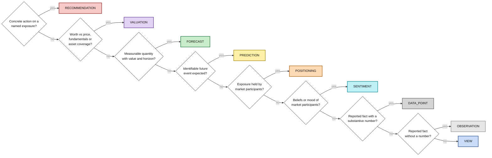

# Claim-type decision tree

Apply the tests in order; the first "yes" decides the type (taxonomy v0.8). Colours mirror `config/theme/argument_map.json`.

| Type | Colour | Allowed roles |
|---|---|---|
| RECOMMENDATION | red `#f8c9c9` | core claim, supporting, risks, conditions, catalysts, qualifiers |
| VALUATION | purple `#e3d4f5` | core claim, supporting, risks, conditions, catalysts, qualifiers |
| FORECAST | green `#c9ecc9` | core claim, supporting, risks, conditions, catalysts, qualifiers |
| PREDICTION | yellow `#fff2a8` | core claim, supporting, risks, conditions, catalysts, qualifiers |
| POSITIONING | orange `#fdd9b5` | all roles; rationale when it only reports holdings or flows |
| SENTIMENT | cyan `#bff0f5` | all roles; rationale when it only reports mood |
| VIEW | blue `#c9dcf8` | core claim, supporting, risks, conditions, catalysts, qualifiers |
| DATA_POINT | dark grey `#d4d4d4` | rationale only |
| OBSERVATION | grey `#e6e6e6` | rationale only |
